# 📊 Minitab Lessons

    

Learn **Minitab** from your first dataset to expert level projects with a free, illustrated, ten level textbook. Every topic explains **what** it is, **why** it matters and **how** to do it in Minitab, with worked examples, exercises and Sig the Statbot as your guide.

<table>
  <tr>
    <th align="center">📕 One level at a time</th>
    <th align="center">📚 Everything in one file</th>
  </tr>
  <tr>
    <td align="center"><a href="#-the-ten-levels">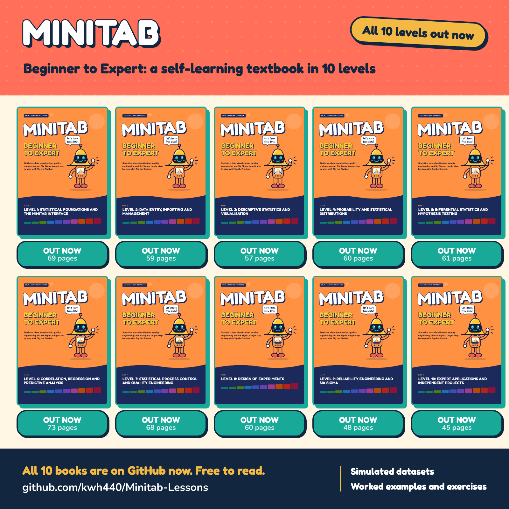</a></td>
    <td align="center"><a href="Minitab%20Complete%20Edition.pdf">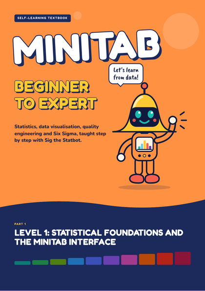</a><br><sub>573 pages with a clickable contents</sub></td>
  </tr>
  <tr>
    <th colspan="2" align="center">
      <h3><a href="#-the-ten-levels">🧩 10 levels, 39 chapters and 50 simulated datasets</a></h3>
    </th>
  </tr>
  <tr>
    <th><a href="#-the-ten-levels">📖 Read</a></th>
    <th><a href="datasets/">🗃️ Practise</a></th>
  </tr>
  <tr>
    <td align="center">Open a PDF and follow each step in Minitab.</td>
    <td align="center">Download the simulated CSV files used in the examples.</td>
  </tr>
</table>

> [!NOTE]
> All datasets are **simulated** for teaching. They are not real company or personal data.

## 👀 A look inside

<table>
  <tr>
    <th align="center">📖 Level 1: Beginner</th>
    <th align="center">🔬 Level 5: Intermediate</th>
    <th align="center">🏭 Level 9: Advanced</th>
  </tr>
  <tr>
    <td align="center"><details open><summary>Level opener</summary>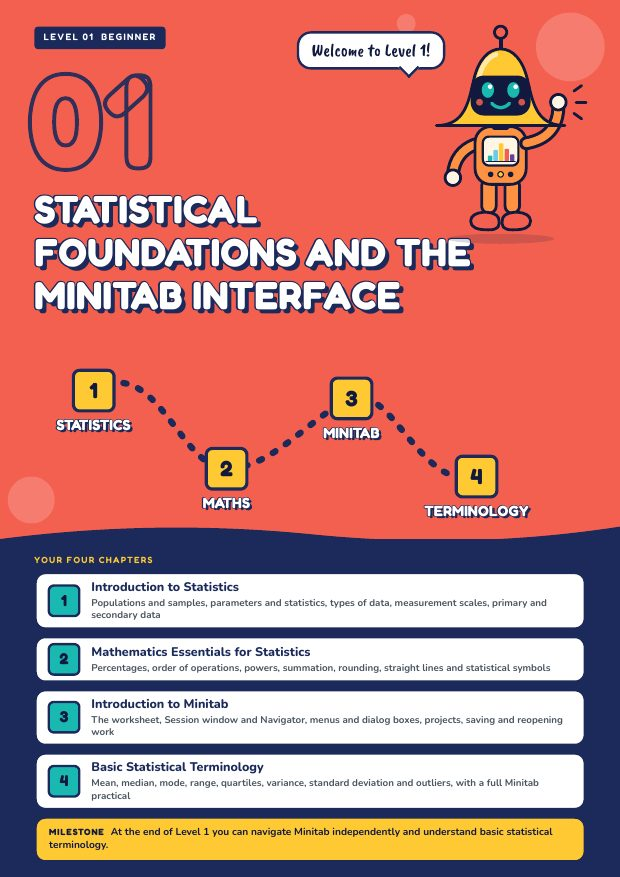</details><details><summary>Chapter opener</summary>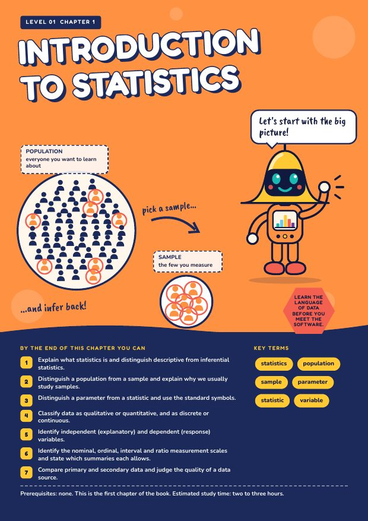</details></td>
    <td align="center"><details open><summary>Level opener</summary>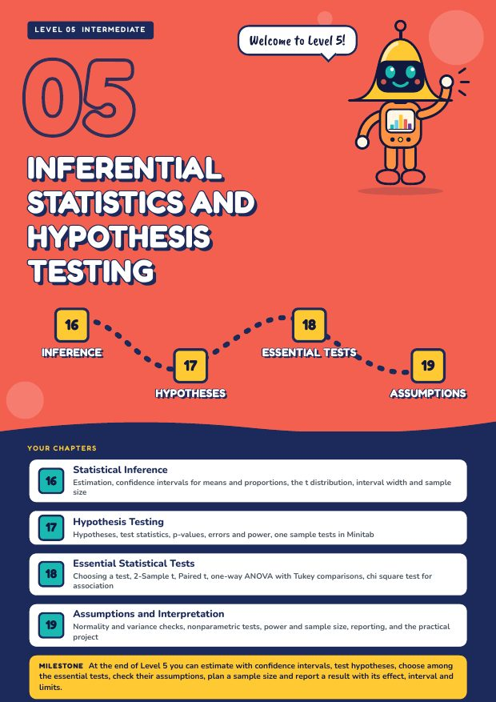</details><details><summary>Cheat sheet</summary>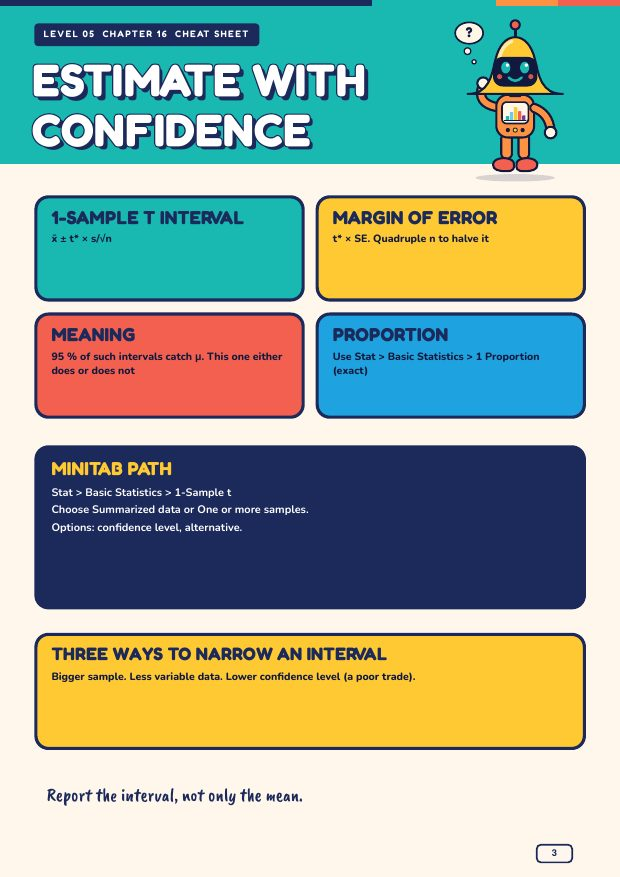</details></td>
    <td align="center"><details open><summary>Level opener</summary>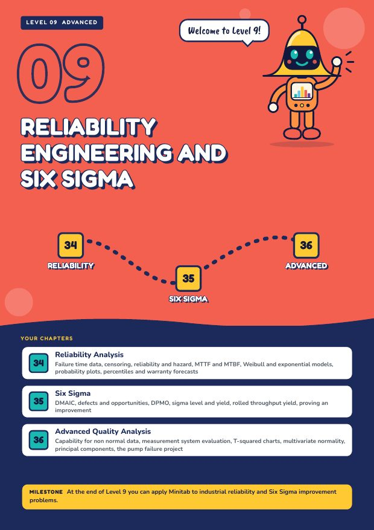</details><details><summary>Cheat sheet</summary>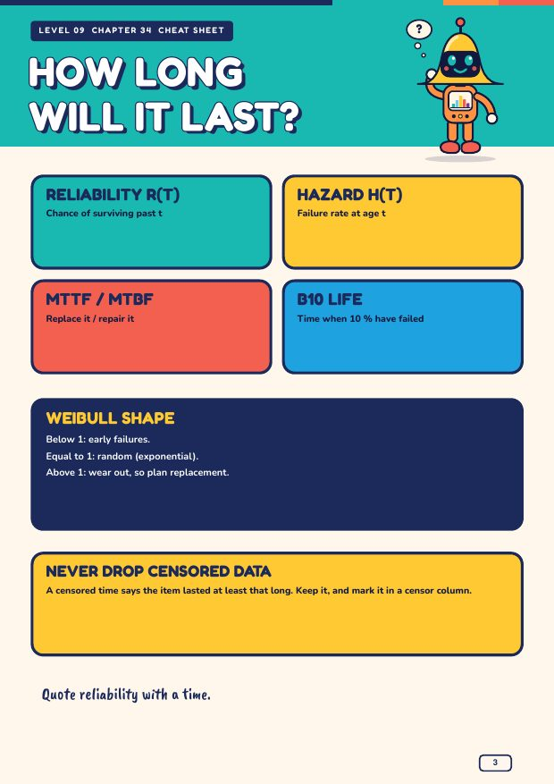</details></td>
  </tr>
</table>

# 📚 Documentation

## 🦮 How to study

There are several ways to use the books, each with its own advantages:

* [📘 One level at a time *(1 to 4 weeks per level)*](#-the-ten-levels)
  * ✔️ Small, focused books
  * ✔️ Easy to track your progress
  * ➖ Ten files to manage
* [📕 The complete edition *(573 pages)*](Minitab%20Complete%20Edition.pdf)
  * ✔️ One searchable file with a clickable contents
  * ➖ Large download
* [🎯 Jump to a topic *(~5 min)*](#-the-ten-levels)
  * ✔️ Open the level page, then the chapter you need
  * ➖ Later levels assume the earlier ones

## 🗺️ The ten levels

<table>
  <tr>
    <th colspan="2"><a href="docs/level-01.md">🌱 Level 1: Statistical Foundations and the Minitab Interface</a></th>
  </tr>
  <tr>
    <td align="center" width="170"><a href="docs/level-01.md"></a></td>
    <td>
      <p>Understand the basic statistical concepts and get comfortable with the Minitab interface.</p>
      <code>Beginner</code> <code>1 week</code> <code>69 pages</code> <code>4 chapters</code> <code>1 datasets</code><br>
      <a href="Minitab%20Lessons/Minitab%20Lesson%20-%20Level%201.pdf">📖 Read the PDF</a> · <a href="docs/level-01.md">🔍 Inside the book</a>
      
    </td>
  </tr>
  <tr>
    <th colspan="2"><a href="docs/level-02.md">🌱 Level 2: Data Entry, Importing and Management</a></th>
  </tr>
  <tr>
    <td align="center" width="170"><a href="docs/level-02.md"></a></td>
    <td>
      <p>Enter, import, clean and manipulate data so it is ready to analyse.</p>
      <code>Beginner</code> <code>1 week</code> <code>59 pages</code> <code>4 chapters</code> <code>6 datasets</code><br>
      <a href="Minitab%20Lessons/Minitab%20Lesson%20-%20Level%202.pdf">📖 Read the PDF</a> · <a href="docs/level-02.md">🔍 Inside the book</a>
      
    </td>
  </tr>
  <tr>
    <th colspan="2"><a href="docs/level-03.md">🌱 Level 3: Descriptive Statistics and Data Visualisation</a></th>
  </tr>
  <tr>
    <td align="center" width="170"><a href="docs/level-03.md"></a></td>
    <td>
      <p>Summarise data with numbers and tell its story with clear graphs.</p>
      <code>Elementary</code> <code>1 to 2 weeks</code> <code>57 pages</code> <code>3 chapters</code> <code>4 datasets</code><br>
      <a href="Minitab%20Lessons/Minitab%20Lesson%20-%20Level%203.pdf">📖 Read the PDF</a> · <a href="docs/level-03.md">🔍 Inside the book</a>
      
    </td>
  </tr>
  <tr>
    <th colspan="2"><a href="docs/level-04.md">🌿 Level 4: Probability and Statistical Distributions</a></th>
  </tr>
  <tr>
    <td align="center" width="170"><a href="docs/level-04.md"></a></td>
    <td>
      <p>Learn the probability and distribution ideas behind every statistical test.</p>
      <code>Intermediate</code> <code>1 to 2 weeks</code> <code>60 pages</code> <code>4 chapters</code> <code>2 datasets</code><br>
      <a href="Minitab%20Lessons/Minitab%20Lesson%20-%20Level%204.pdf">📖 Read the PDF</a> · <a href="docs/level-04.md">🔍 Inside the book</a>
      
    </td>
  </tr>
  <tr>
    <th colspan="2"><a href="docs/level-05.md">🌿 Level 5: Inferential Statistics and Hypothesis Testing</a></th>
  </tr>
  <tr>
    <td align="center" width="170"><a href="docs/level-05.md"></a></td>
    <td>
      <p>Estimate with confidence, test hypotheses and check the assumptions behind the tests.</p>
      <code>Intermediate</code> <code>2 weeks</code> <code>61 pages</code> <code>4 chapters</code> <code>5 datasets</code><br>
      <a href="Minitab%20Lessons/Minitab%20Lesson%20-%20Level%205.pdf">📖 Read the PDF</a> · <a href="docs/level-05.md">🔍 Inside the book</a>
      
    </td>
  </tr>
  <tr>
    <th colspan="2"><a href="docs/level-06.md">🌿 Level 6: Correlation, Regression and Predictive Analysis</a></th>
  </tr>
  <tr>
    <td align="center" width="170"><a href="docs/level-06.md">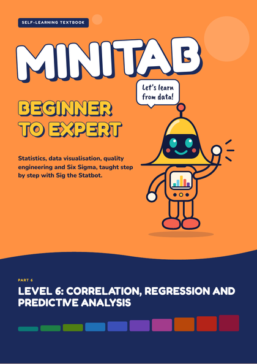</a></td>
    <td>
      <p>Model relationships between variables and use them to predict and forecast.</p>
      <code>Intermediate to Advanced</code> <code>2 weeks</code> <code>73 pages</code> <code>5 chapters</code> <code>6 datasets</code><br>
      <a href="Minitab%20Lessons/Minitab%20Lesson%20-%20Level%206.pdf">📖 Read the PDF</a> · <a href="docs/level-06.md">🔍 Inside the book</a>
      
    </td>
  </tr>
  <tr>
    <th colspan="2"><a href="docs/level-07.md">🌳 Level 7: Statistical Process Control and Quality Engineering</a></th>
  </tr>
  <tr>
    <td align="center" width="170"><a href="docs/level-07.md">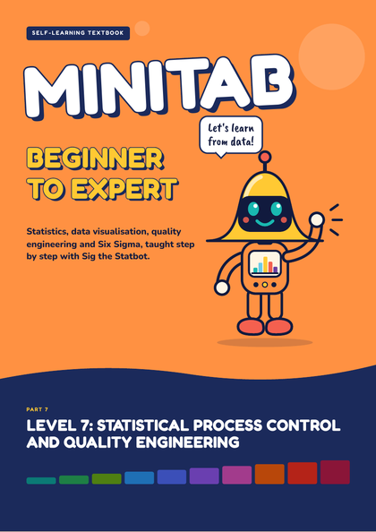</a></td>
    <td>
      <p>Monitor processes with control charts, measure capability and check measurement systems.</p>
      <code>Advanced</code> <code>2 weeks</code> <code>68 pages</code> <code>5 chapters</code> <code>11 datasets</code><br>
      <a href="Minitab%20Lessons/Minitab%20Lesson%20-%20Level%207.pdf">📖 Read the PDF</a> · <a href="docs/level-07.md">🔍 Inside the book</a>
      
    </td>
  </tr>
  <tr>
    <th colspan="2"><a href="docs/level-08.md">🌳 Level 8: Design of Experiments</a></th>
  </tr>
  <tr>
    <td align="center" width="170"><a href="docs/level-08.md">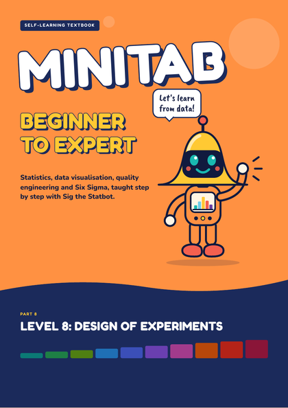</a></td>
    <td>
      <p>Plan experiments, analyse the results and find the best settings.</p>
      <code>Advanced</code> <code>2 weeks</code> <code>60 pages</code> <code>4 chapters</code> <code>4 datasets</code><br>
      <a href="Minitab%20Lessons/Minitab%20Lesson%20-%20Level%208.pdf">📖 Read the PDF</a> · <a href="docs/level-08.md">🔍 Inside the book</a>
      
    </td>
  </tr>
  <tr>
    <th colspan="2"><a href="docs/level-09.md">🌳 Level 9: Reliability Engineering and Six Sigma</a></th>
  </tr>
  <tr>
    <td align="center" width="170"><a href="docs/level-09.md">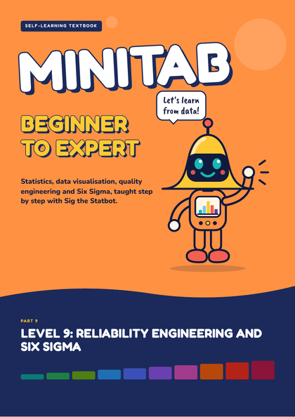</a></td>
    <td>
      <p>Analyse failure data and apply Six Sigma methods to improve processes.</p>
      <code>Advanced</code> <code>2 to 3 weeks</code> <code>48 pages</code> <code>3 chapters</code> <code>7 datasets</code><br>
      <a href="Minitab%20Lessons/Minitab%20Lesson%20-%20Level%209.pdf">📖 Read the PDF</a> · <a href="docs/level-09.md">🔍 Inside the book</a>
      
    </td>
  </tr>
  <tr>
    <th colspan="2"><a href="docs/level-10.md">🏆 Level 10: Expert Applications and Independent Projects</a></th>
  </tr>
  <tr>
    <td align="center" width="170"><a href="docs/level-10.md">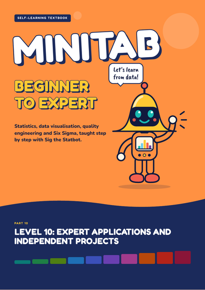</a></td>
    <td>
      <p>Combine everything into professional workflows, reports and independent projects.</p>
      <code>Expert</code> <code>2 to 4 weeks</code> <code>45 pages</code> <code>3 chapters</code> <code>4 datasets</code><br>
      <a href="Minitab%20Lessons/Minitab%20Lesson%20-%20Level%2010.pdf">📖 Read the PDF</a> · <a href="docs/level-10.md">🔍 Inside the book</a>
      
    </td>
  </tr>
</table>

## 🧭 Learning path

* 🌱 **Beginner and elementary**: [Level 1](docs/level-01.md), [Level 2](docs/level-02.md), [Level 3](docs/level-03.md)
* 🌿 **Intermediate**: [Level 4](docs/level-04.md), [Level 5](docs/level-05.md), [Level 6](docs/level-06.md)
* 🌳 **Advanced**: [Level 7](docs/level-07.md), [Level 8](docs/level-08.md), [Level 9](docs/level-09.md)
* 🏆 **Expert**: [Level 10](docs/level-10.md)

## 🧱 How every chapter is built

* 🎯 **Learning objectives** and prerequisites open each chapter
* 🧠 **WHAT, WHY, HOW** for every topic, in plain words
* 🖱️ **Minitab Steps** with menu paths you can follow click by click
* 🌍 **Real World Examples**, **Pro Tips** and **Common Mistakes**
* ✍️ **Try It Yourself** tasks, exercises and an answer key
* 🗒️ **Cheat sheet pages**, a glossary and references

## 📁 Repository structure

```text
Minitab-Lessons/
├── Minitab Lessons/            Ten level PDFs (Level 1 to Level 10)
├── Minitab Complete Edition.pdf   All ten levels in one PDF
├── datasets/           50 simulated CSV files
├── docs/               One page per level
└── assets/             Covers and sample pages
```

## ⚠️ Good to know

* Written in **British English**.
* Some Minitab menu paths and output layouts in Levels 7 to 10 were prepared without a live Minitab session. Compare them with your version and report differences.
* Minitab is a trademark of Minitab, LLC. This project is independent and is not affiliated with or endorsed by Minitab, LLC.

## 💪 Contributing

Found a mistake or want a topic explained better? Please open an [issue](../../issues).

## 📜 License

Add your licence here, for example [CC BY 4.0](https://creativecommons.org/licenses/by/4.0/) for the books. Until then, all rights are reserved by the author.

Made with 🧡 by **kwh440**
