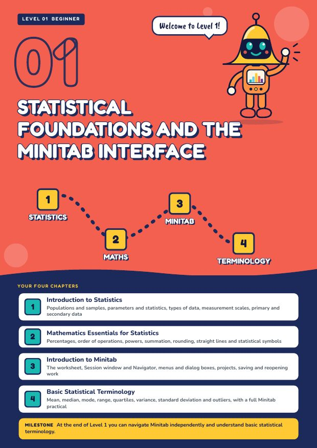
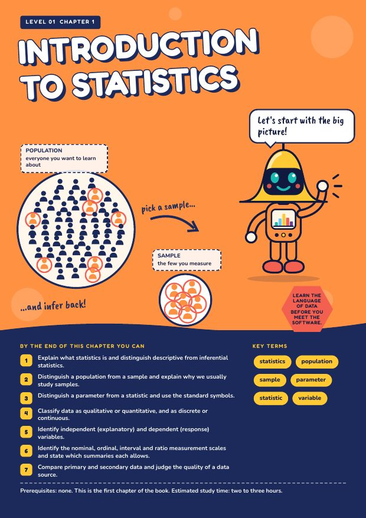
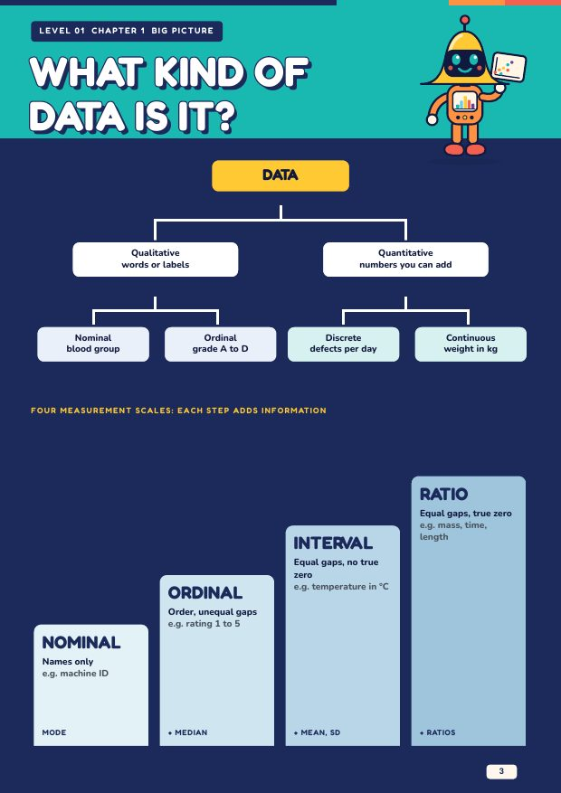

<table>
  <tr><td colspan="2"><a href="../README.md#-the-ten-levels">← Back to the levels index</a></td></tr>
  <tr><th colspan="2"><h3>🌱 Level 1: Statistical Foundations and the Minitab Interface</h3></th></tr>
  <tr><td colspan="2" align="center">
Understand the basic statistical concepts and get comfortable with the Minitab interface.
</td></tr>
  <tr>
    <th rowspan="3">At a glance <a href="../Minitab%20Lessons/Minitab%20Lesson%20-%20Level%201.pdf">→ Open the PDF</a></th>
    <td><code>🌱 Beginner</code> <code>⏱️ 1 week</code> <code>📄 69 pages</code></td>
  </tr>
  <tr><td><code>📚 4 chapters (numbered 1 to 4)</code> <code>🗃️ 1 simulated dataset</code></td></tr>
  <tr><td><code>🧠 WHAT</code> <code>🎯 WHY</code> <code>🛠️ HOW</code> <code>✍️ Exercises and answer key</code> <code>📖 Glossary</code></td></tr>
  <tr>
    <td colspan="2" align="center">
      

Level opener

      

Chapter opener

      

Cheat sheet page

      
    </td>
  </tr>
</table>

## 📚 Chapters

<table>
<tr><th align="center">No.</th><th align="left">Chapter</th></tr>
<tr><td align="center"><b>1</b></td><td>Introduction to Statistics</td></tr>
<tr><td align="center"><b>2</b></td><td>Mathematics Essentials for Statistics</td></tr>
<tr><td align="center"><b>3</b></td><td>Introduction to Minitab</td></tr>
<tr><td align="center"><b>4</b></td><td>Basic Statistical Terminology</td></tr>
</table>

## 🗃️ Datasets

All datasets are **simulated** and live in [`../datasets/`](../datasets/).

<table>
<tr><th align="left">File</th><th align="left">What it holds</th></tr>
<tr><td><code>L01_CH03_DS01_Student_Marks_20.csv</code></td><td>Student Marks 20</td></tr>
</table>

---

[Level 2 →](level-02.md)
