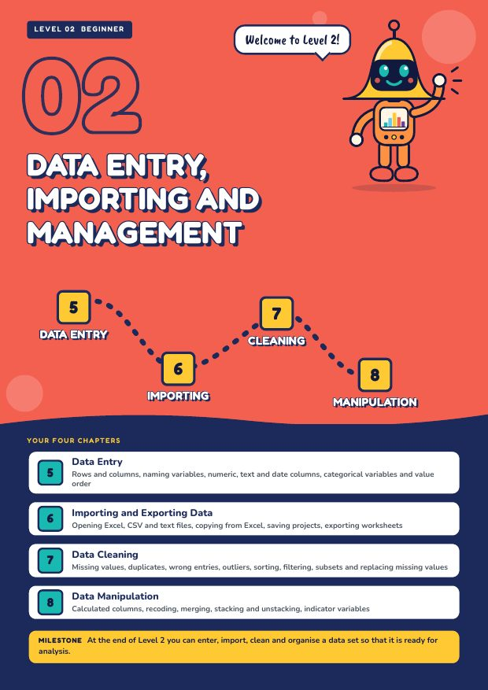
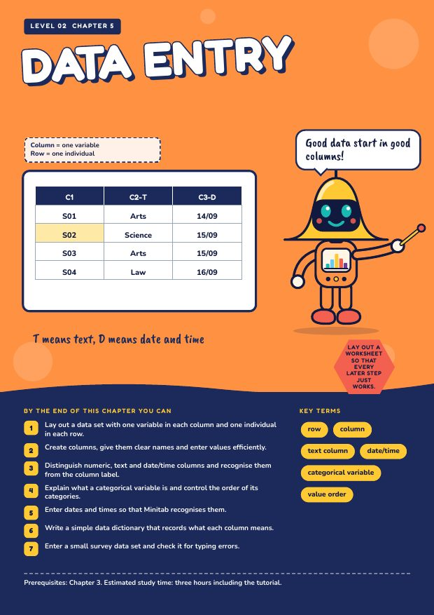
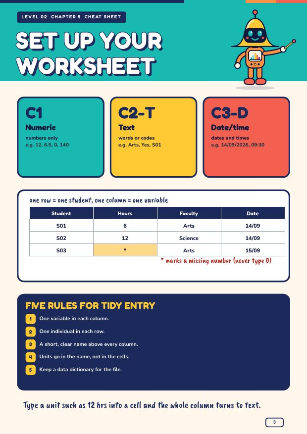

<table>
  <tr><td colspan="2"><a href="../README.md#-the-ten-levels">← Back to the levels index</a></td></tr>
  <tr><th colspan="2"><h3>🌱 Level 2: Data Entry, Importing and Management</h3></th></tr>
  <tr><td colspan="2" align="center">
Enter, import, clean and manipulate data so it is ready to analyse.
</td></tr>
  <tr>
    <th rowspan="3">At a glance <a href="../Minitab%20Lessons/Minitab%20Lesson%20-%20Level%202.pdf">→ Open the PDF</a></th>
    <td><code>🌱 Beginner</code> <code>⏱️ 1 week</code> <code>📄 59 pages</code></td>
  </tr>
  <tr><td><code>📚 4 chapters (numbered 5 to 8)</code> <code>🗃️ 6 simulated datasets</code></td></tr>
  <tr><td><code>🧠 WHAT</code> <code>🎯 WHY</code> <code>🛠️ HOW</code> <code>✍️ Exercises and answer key</code> <code>📖 Glossary</code></td></tr>
  <tr>
    <td colspan="2" align="center">
      

Level opener

      

Chapter opener

      

Cheat sheet page

      
    </td>
  </tr>
</table>

## 📚 Chapters

<table>
<tr><th align="center">No.</th><th align="left">Chapter</th></tr>
<tr><td align="center"><b>5</b></td><td>Data Entry</td></tr>
<tr><td align="center"><b>6</b></td><td>Importing and Exporting Data</td></tr>
<tr><td align="center"><b>7</b></td><td>Data Cleaning</td></tr>
<tr><td align="center"><b>8</b></td><td>Data Manipulation</td></tr>
</table>

## 🗃️ Datasets

All datasets are **simulated** and live in [`../datasets/`](../datasets/).

<table>
<tr><th align="left">File</th><th align="left">What it holds</th></tr>
<tr><td><code>L02_CH01_DS01_Study_Survey_12.csv</code></td><td>Study Survey 12</td></tr>
<tr><td><code>L02_CH02_DS01_Machine_Output_24.csv</code></td><td>Machine Output 24</td></tr>
<tr><td><code>L02_CH03_DS01_Messy_Orders_30.csv</code></td><td>Messy Orders 30</td></tr>
<tr><td><code>L02_CH03_DS02_Clean_Orders_29.csv</code></td><td>Clean Orders 29</td></tr>
<tr><td><code>L02_CH04_DS01_Sales_By_Quarter.csv</code></td><td>Sales By Quarter</td></tr>
<tr><td><code>L02_CH04_DS02_Store_Details.csv</code></td><td>Store Details</td></tr>
</table>

---

[← Level 1](level-01.md) · [Level 3 →](level-03.md)
