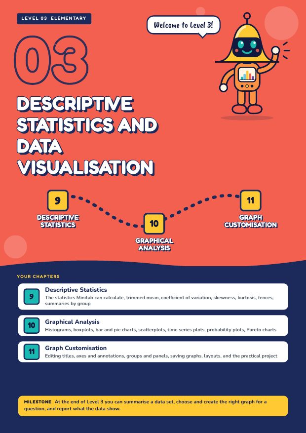
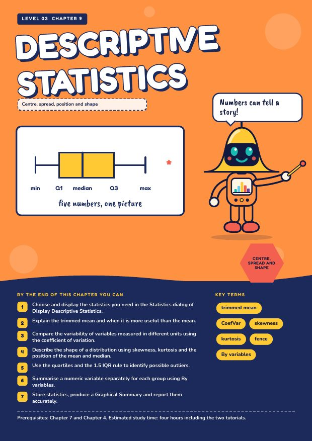
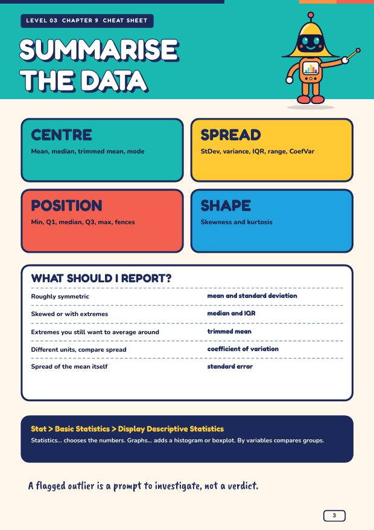

<table>
  <tr><td colspan="2"><a href="../README.md#-the-ten-levels">← Back to the levels index</a></td></tr>
  <tr><th colspan="2"><h3>🌱 Level 3: Descriptive Statistics and Data Visualisation</h3></th></tr>
  <tr><td colspan="2" align="center">
Summarise data with numbers and tell its story with clear graphs.
</td></tr>
  <tr>
    <th rowspan="3">At a glance <a href="../Minitab%20Lessons/Minitab%20Lesson%20-%20Level%203.pdf">→ Open the PDF</a></th>
    <td><code>🌱 Elementary</code> <code>⏱️ 1 to 2 weeks</code> <code>📄 57 pages</code></td>
  </tr>
  <tr><td><code>📚 3 chapters (numbered 9 to 11)</code> <code>🗃️ 4 simulated datasets</code></td></tr>
  <tr><td><code>🧠 WHAT</code> <code>🎯 WHY</code> <code>🛠️ HOW</code> <code>✍️ Exercises and answer key</code> <code>📖 Glossary</code></td></tr>
  <tr>
    <td colspan="2" align="center">
      

Level opener

      

Chapter opener

      

Cheat sheet page

      
    </td>
  </tr>
</table>

## 📚 Chapters

<table>
<tr><th align="center">No.</th><th align="left">Chapter</th></tr>
<tr><td align="center"><b>9</b></td><td>Descriptive Statistics</td></tr>
<tr><td align="center"><b>10</b></td><td>Graphical Analysis</td></tr>
<tr><td align="center"><b>11</b></td><td>Graph Customisation</td></tr>
</table>

## 🗃️ Datasets

All datasets are **simulated** and live in [`../datasets/`](../datasets/).

<table>
<tr><th align="left">File</th><th align="left">What it holds</th></tr>
<tr><td><code>L03_CH01_DS01_Delivery_Times_20.csv</code></td><td>Delivery Times 20</td></tr>
<tr><td><code>L03_CH02_DS01_Exam_Results_100.csv</code></td><td>Exam Results 100</td></tr>
<tr><td><code>L03_CH02_DS02_Monthly_Sales_36.csv</code></td><td>Monthly Sales 36</td></tr>
<tr><td><code>L03_CH02_DS03_Return_Reasons.csv</code></td><td>Return Reasons</td></tr>
</table>

---

[← Level 2](level-02.md) · [Level 4 →](level-04.md)
