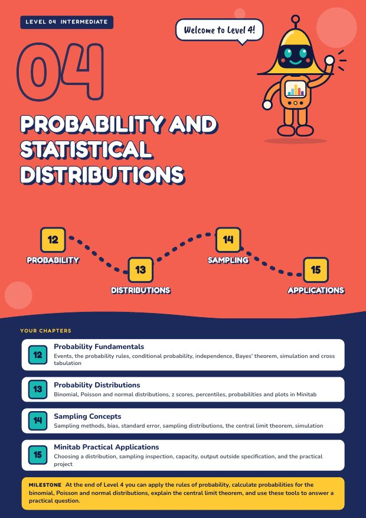
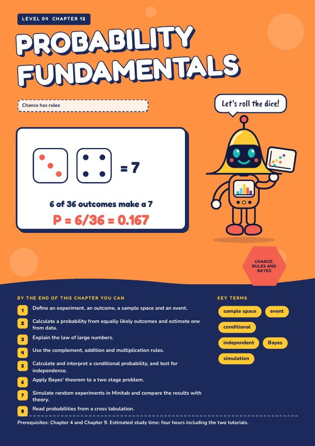
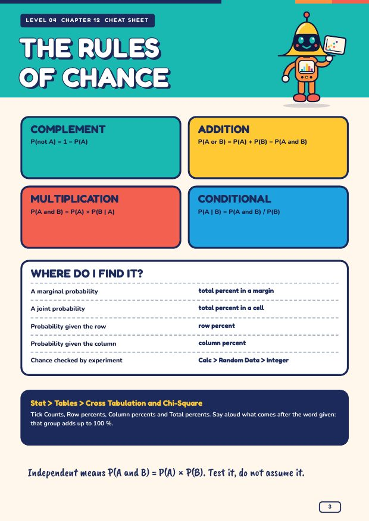

<table>
  <tr><td colspan="2"><a href="../README.md#-the-ten-levels">← Back to the levels index</a></td></tr>
  <tr><th colspan="2"><h3>🌿 Level 4: Probability and Statistical Distributions</h3></th></tr>
  <tr><td colspan="2" align="center">
Learn the probability and distribution ideas behind every statistical test.
</td></tr>
  <tr>
    <th rowspan="3">At a glance <a href="../Minitab%20Lessons/Minitab%20Lesson%20-%20Level%204.pdf">→ Open the PDF</a></th>
    <td><code>🌿 Intermediate</code> <code>⏱️ 1 to 2 weeks</code> <code>📄 60 pages</code></td>
  </tr>
  <tr><td><code>📚 4 chapters (numbered 12 to 15)</code> <code>🗃️ 2 simulated datasets</code></td></tr>
  <tr><td><code>🧠 WHAT</code> <code>🎯 WHY</code> <code>🛠️ HOW</code> <code>✍️ Exercises and answer key</code> <code>📖 Glossary</code></td></tr>
  <tr>
    <td colspan="2" align="center">
      

Level opener

      

Chapter opener

      

Cheat sheet page

      
    </td>
  </tr>
</table>

## 📚 Chapters

<table>
<tr><th align="center">No.</th><th align="left">Chapter</th></tr>
<tr><td align="center"><b>12</b></td><td>Probability Fundamentals</td></tr>
<tr><td align="center"><b>13</b></td><td>Probability Distributions</td></tr>
<tr><td align="center"><b>14</b></td><td>Sampling Concepts</td></tr>
<tr><td align="center"><b>15</b></td><td>Minitab Practical Applications</td></tr>
</table>

## 🗃️ Datasets

All datasets are **simulated** and live in [`../datasets/`](../datasets/).

<table>
<tr><th align="left">File</th><th align="left">What it holds</th></tr>
<tr><td><code>L04_CH03_DS01_Population_Parcels_2000.csv</code></td><td>Population Parcels 2000</td></tr>
<tr><td><code>L04_CH04_DS01_Bottle_Fills_200.csv</code></td><td>Bottle Fills 200</td></tr>
</table>

---

[← Level 3](level-03.md) · [Level 5 →](level-05.md)
