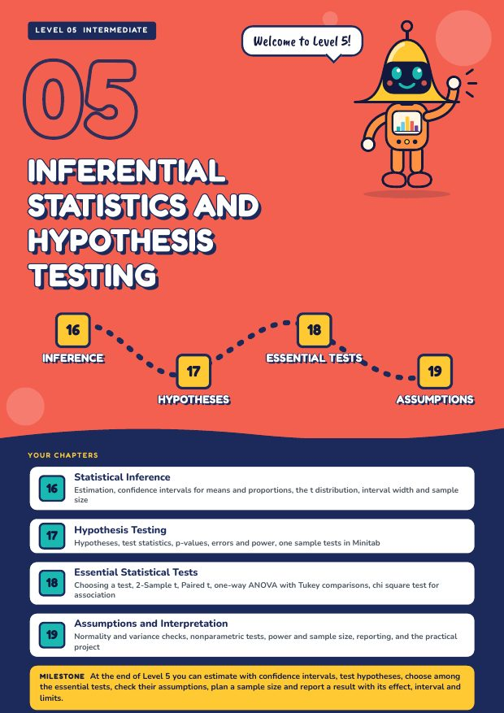
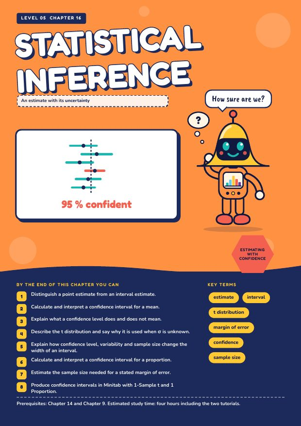
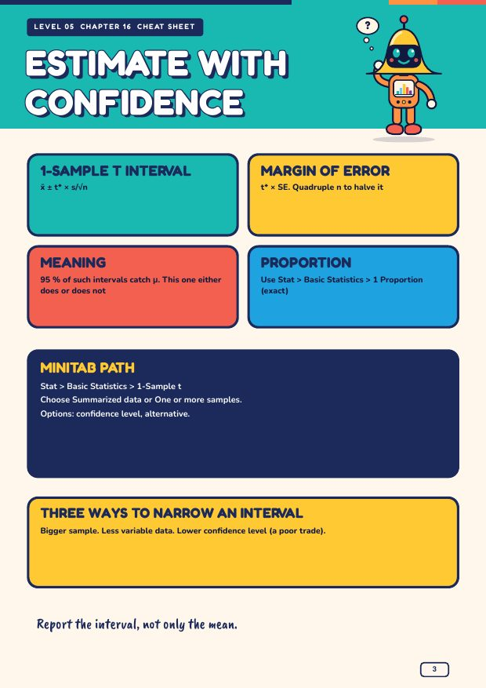

<table>
  <tr><td colspan="2"><a href="../README.md#-the-ten-levels">← Back to the levels index</a></td></tr>
  <tr><th colspan="2"><h3>🌿 Level 5: Inferential Statistics and Hypothesis Testing</h3></th></tr>
  <tr><td colspan="2" align="center">
Estimate with confidence, test hypotheses and check the assumptions behind the tests.
</td></tr>
  <tr>
    <th rowspan="3">At a glance <a href="../Minitab%20Lessons/Minitab%20Lesson%20-%20Level%205.pdf">→ Open the PDF</a></th>
    <td><code>🌿 Intermediate</code> <code>⏱️ 2 weeks</code> <code>📄 61 pages</code></td>
  </tr>
  <tr><td><code>📚 4 chapters (numbered 16 to 19)</code> <code>🗃️ 5 simulated datasets</code></td></tr>
  <tr><td><code>🧠 WHAT</code> <code>🎯 WHY</code> <code>🛠️ HOW</code> <code>✍️ Exercises and answer key</code> <code>📖 Glossary</code></td></tr>
  <tr>
    <td colspan="2" align="center">
      

Level opener

      

Chapter opener

      

Cheat sheet page

      
    </td>
  </tr>
</table>

## 📚 Chapters

<table>
<tr><th align="center">No.</th><th align="left">Chapter</th></tr>
<tr><td align="center"><b>16</b></td><td>Statistical Inference</td></tr>
<tr><td align="center"><b>17</b></td><td>Hypothesis Testing</td></tr>
<tr><td align="center"><b>18</b></td><td>Essential Statistical Tests</td></tr>
<tr><td align="center"><b>19</b></td><td>Assumptions and Interpretation</td></tr>
</table>

## 🗃️ Datasets

All datasets are **simulated** and live in [`../datasets/`](../datasets/).

<table>
<tr><th align="left">File</th><th align="left">What it holds</th></tr>
<tr><td><code>L05_CH03_DS01_Teaching_Methods_60.csv</code></td><td>Teaching Methods 60</td></tr>
<tr><td><code>L05_CH03_DS02_Training_Paired_20.csv</code></td><td>Training Paired 20</td></tr>
<tr><td><code>L05_CH03_DS03_Supplier_Strength_60.csv</code></td><td>Supplier Strength 60</td></tr>
<tr><td><code>L05_CH03_DS04_Satisfaction_Table.csv</code></td><td>Satisfaction Table</td></tr>
<tr><td><code>L05_CH04_DS01_Handling_Times_50.csv</code></td><td>Handling Times 50</td></tr>
</table>

---

[← Level 4](level-04.md) · [Level 6 →](level-06.md)
