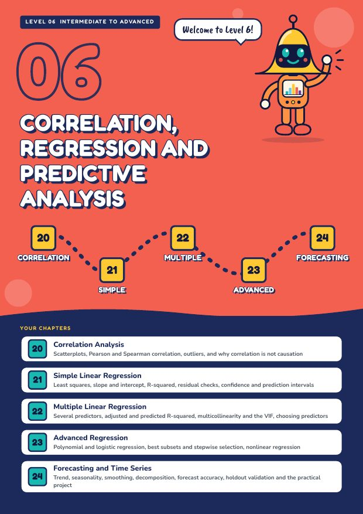
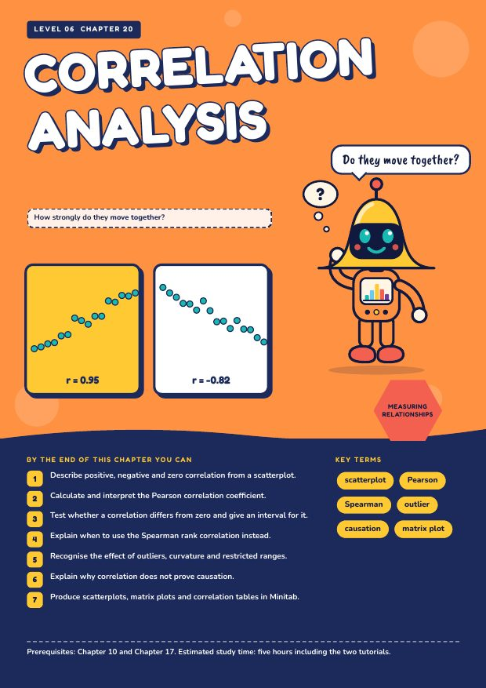
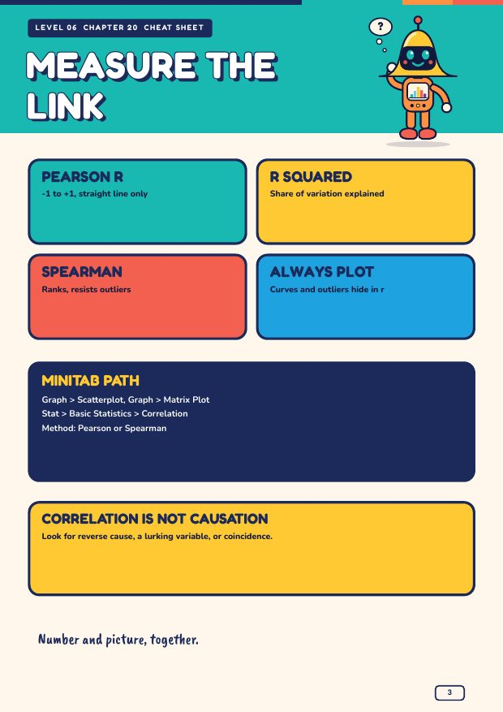

<table>
  <tr><td colspan="2"><a href="../README.md#-the-ten-levels">← Back to the levels index</a></td></tr>
  <tr><th colspan="2"><h3>🌿 Level 6: Correlation, Regression and Predictive Analysis</h3></th></tr>
  <tr><td colspan="2" align="center">
Model relationships between variables and use them to predict and forecast.
</td></tr>
  <tr>
    <th rowspan="3">At a glance <a href="../Minitab%20Lessons/Minitab%20Lesson%20-%20Level%206.pdf">→ Open the PDF</a></th>
    <td><code>🌿 Intermediate to Advanced</code> <code>⏱️ 2 weeks</code> <code>📄 73 pages</code></td>
  </tr>
  <tr><td><code>📚 5 chapters (numbered 20 to 24)</code> <code>🗃️ 6 simulated datasets</code></td></tr>
  <tr><td><code>🧠 WHAT</code> <code>🎯 WHY</code> <code>🛠️ HOW</code> <code>✍️ Exercises and answer key</code> <code>📖 Glossary</code></td></tr>
  <tr>
    <td colspan="2" align="center">
      

Level opener

      

Chapter opener

      

Cheat sheet page

      
    </td>
  </tr>
</table>

## 📚 Chapters

<table>
<tr><th align="center">No.</th><th align="left">Chapter</th></tr>
<tr><td align="center"><b>20</b></td><td>Correlation Analysis</td></tr>
<tr><td align="center"><b>21</b></td><td>Simple Linear Regression</td></tr>
<tr><td align="center"><b>22</b></td><td>Multiple Linear Regression</td></tr>
<tr><td align="center"><b>23</b></td><td>Advanced Regression</td></tr>
<tr><td align="center"><b>24</b></td><td>Forecasting and Time Series</td></tr>
</table>

## 🗃️ Datasets

All datasets are **simulated** and live in [`../datasets/`](../datasets/).

<table>
<tr><th align="left">File</th><th align="left">What it holds</th></tr>
<tr><td><code>L06_CH01_DS01_Hours_Marks_40.csv</code></td><td>Hours Marks 40</td></tr>
<tr><td><code>L06_CH03_DS01_House_Prices_80.csv</code></td><td>House Prices 80</td></tr>
<tr><td><code>L06_CH04_DS01_Yield_Temperature_30.csv</code></td><td>Yield Temperature 30</td></tr>
<tr><td><code>L06_CH04_DS02_Machine_Failure_150.csv</code></td><td>Machine Failure 150</td></tr>
<tr><td><code>L06_CH05_DS01_Monthly_Sales_48.csv</code></td><td>Monthly Sales 48</td></tr>
<tr><td><code>L06_CH05_DS02_Exam_Marks_120.csv</code></td><td>Exam Marks 120</td></tr>
</table>

---

[← Level 5](level-05.md) · [Level 7 →](level-07.md)
