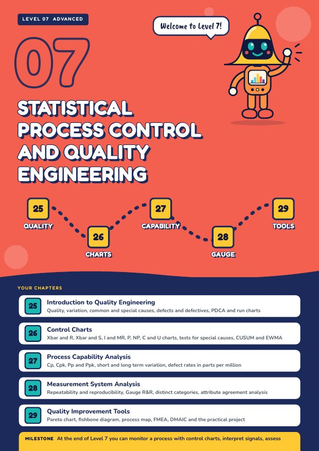
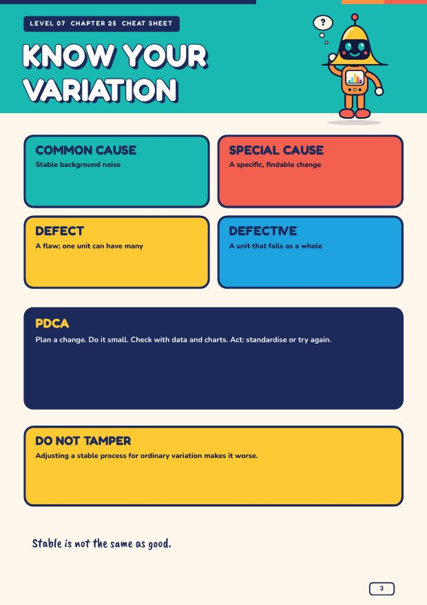

<table>
  <tr><td colspan="2"><a href="../README.md#-the-ten-levels">← Back to the levels index</a></td></tr>
  <tr><th colspan="2"><h3>🌳 Level 7: Statistical Process Control and Quality Engineering</h3></th></tr>
  <tr><td colspan="2" align="center">
Monitor processes with control charts, measure capability and check measurement systems.
</td></tr>
  <tr>
    <th rowspan="3">At a glance <a href="../Minitab%20Lessons/Minitab%20Lesson%20-%20Level%207.pdf">→ Open the PDF</a></th>
    <td><code>🌳 Advanced</code> <code>⏱️ 2 weeks</code> <code>📄 68 pages</code></td>
  </tr>
  <tr><td><code>📚 5 chapters (numbered 25 to 29)</code> <code>🗃️ 11 simulated datasets</code></td></tr>
  <tr><td><code>🧠 WHAT</code> <code>🎯 WHY</code> <code>🛠️ HOW</code> <code>✍️ Exercises and answer key</code> <code>📖 Glossary</code></td></tr>
  <tr>
    <td colspan="2" align="center">
      

Level opener

      

Chapter opener

      

Cheat sheet page

      
    </td>
  </tr>
</table>

## 📚 Chapters

<table>
<tr><th align="center">No.</th><th align="left">Chapter</th></tr>
<tr><td align="center"><b>25</b></td><td>Introduction to Quality Engineering</td></tr>
<tr><td align="center"><b>26</b></td><td>Control Charts</td></tr>
<tr><td align="center"><b>27</b></td><td>Process Capability Analysis</td></tr>
<tr><td align="center"><b>28</b></td><td>Measurement System Analysis</td></tr>
<tr><td align="center"><b>29</b></td><td>Quality Improvement Tools</td></tr>
</table>

## 🗃️ Datasets

All datasets are **simulated** and live in [`../datasets/`](../datasets/).

<table>
<tr><th align="left">File</th><th align="left">What it holds</th></tr>
<tr><td><code>L07_CH02_DS01_Shaft_Diameters_25x5.csv</code></td><td>Shaft Diameters 25x5</td></tr>
<tr><td><code>L07_CH02_DS02_Viscosity_30.csv</code></td><td>Viscosity 30</td></tr>
<tr><td><code>L07_CH02_DS03_Moisture_40.csv</code></td><td>Moisture 40</td></tr>
<tr><td><code>L07_CH02_DS04_Daily_Defectives_25.csv</code></td><td>Daily Defectives 25</td></tr>
<tr><td><code>L07_CH02_DS05_Panel_Defects_25.csv</code></td><td>Panel Defects 25</td></tr>
<tr><td><code>L07_CH03_DS01_Shaft_Capability_30x5.csv</code></td><td>Shaft Capability 30x5</td></tr>
<tr><td><code>L07_CH04_DS01_Gauge_RR_60.csv</code></td><td>Gauge RR 60</td></tr>
<tr><td><code>L07_CH04_DS02_Attribute_Agreement_144.csv</code></td><td>Attribute Agreement 144</td></tr>
<tr><td><code>L07_CH05_DS01_Defect_Counts.csv</code></td><td>Defect Counts</td></tr>
<tr><td><code>L07_CH05_DS02_FMEA_Table.csv</code></td><td>FMEA Table</td></tr>
<tr><td><code>L07_CH05_DS03_Bore_Diameters_30x5.csv</code></td><td>Bore Diameters 30x5</td></tr>
</table>

---

[← Level 6](level-06.md) · [Level 8 →](level-08.md)
