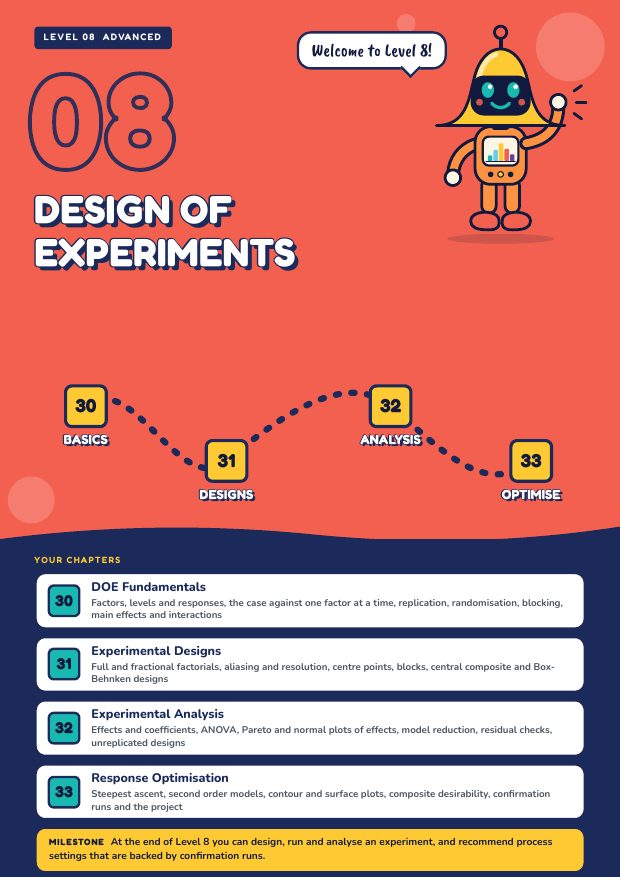
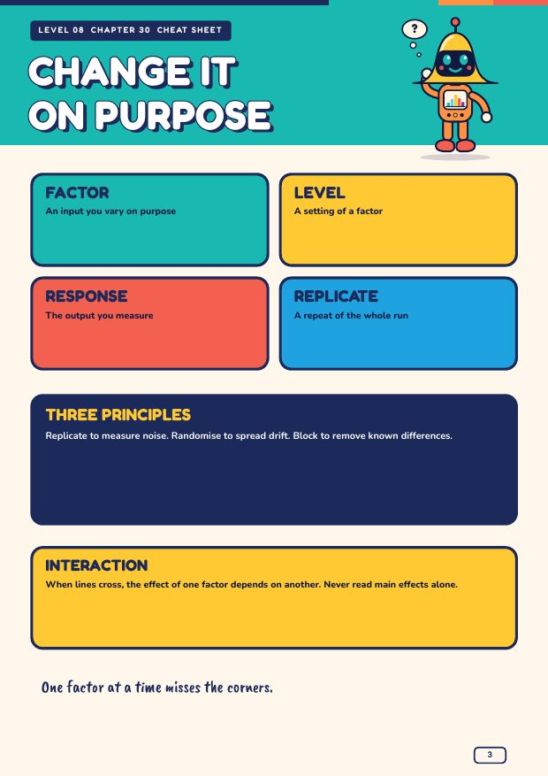

<table>
  <tr><td colspan="2"><a href="../README.md#-the-ten-levels">← Back to the levels index</a></td></tr>
  <tr><th colspan="2"><h3>🌳 Level 8: Design of Experiments</h3></th></tr>
  <tr><td colspan="2" align="center">
Plan experiments, analyse the results and find the best settings.
</td></tr>
  <tr>
    <th rowspan="3">At a glance <a href="../Minitab%20Lessons/Minitab%20Lesson%20-%20Level%208.pdf">→ Open the PDF</a></th>
    <td><code>🌳 Advanced</code> <code>⏱️ 2 weeks</code> <code>📄 60 pages</code></td>
  </tr>
  <tr><td><code>📚 4 chapters (numbered 30 to 33)</code> <code>🗃️ 4 simulated datasets</code></td></tr>
  <tr><td><code>🧠 WHAT</code> <code>🎯 WHY</code> <code>🛠️ HOW</code> <code>✍️ Exercises and answer key</code> <code>📖 Glossary</code></td></tr>
  <tr>
    <td colspan="2" align="center">
      

Level opener

      

Chapter opener

      

Cheat sheet page

      
    </td>
  </tr>
</table>

## 📚 Chapters

<table>
<tr><th align="center">No.</th><th align="left">Chapter</th></tr>
<tr><td align="center"><b>30</b></td><td>DOE Fundamentals</td></tr>
<tr><td align="center"><b>31</b></td><td>Experimental Designs</td></tr>
<tr><td align="center"><b>32</b></td><td>Experimental Analysis</td></tr>
<tr><td align="center"><b>33</b></td><td>Response Optimisation</td></tr>
</table>

## 🗃️ Datasets

All datasets are **simulated** and live in [`../datasets/`](../datasets/).

<table>
<tr><th align="left">File</th><th align="left">What it holds</th></tr>
<tr><td><code>L08_CH01_DS01_Yield_2x2.csv</code></td><td>Yield 2x2</td></tr>
<tr><td><code>L08_CH03_DS01_Seal_Strength_2cubed_16.csv</code></td><td>Seal Strength 2cubed 16</td></tr>
<tr><td><code>L08_CH03_DS02_Conversion_2to4_16.csv</code></td><td>Conversion 2to4 16</td></tr>
<tr><td><code>L08_CH04_DS01_CCD_Yield_Impurity_13.csv</code></td><td>CCD Yield Impurity 13</td></tr>
</table>

---

[← Level 7](level-07.md) · [Level 9 →](level-09.md)
