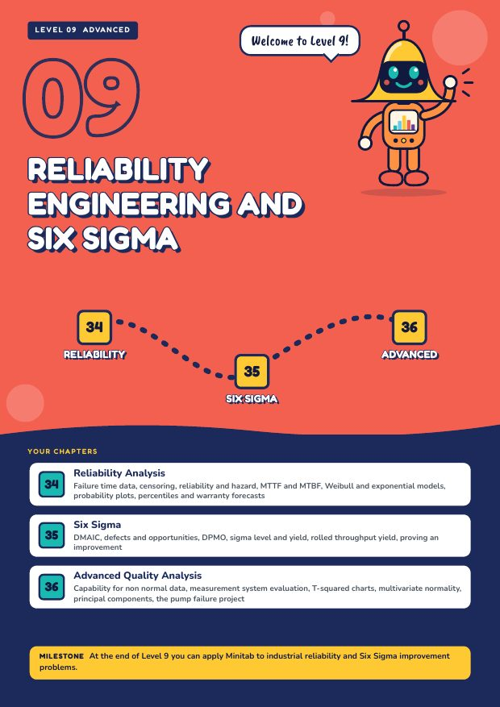
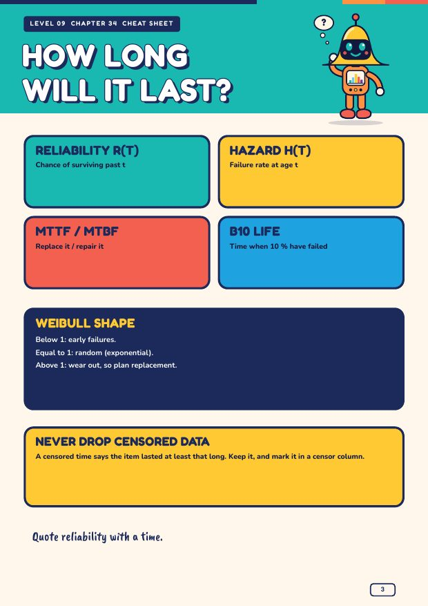

<table>
  <tr><td colspan="2"><a href="../README.md#-the-ten-levels">← Back to the levels index</a></td></tr>
  <tr><th colspan="2"><h3>🌳 Level 9: Reliability Engineering and Six Sigma</h3></th></tr>
  <tr><td colspan="2" align="center">
Analyse failure data and apply Six Sigma methods to improve processes.
</td></tr>
  <tr>
    <th rowspan="3">At a glance <a href="../Minitab%20Lessons/Minitab%20Lesson%20-%20Level%209.pdf">→ Open the PDF</a></th>
    <td><code>🌳 Advanced</code> <code>⏱️ 2 to 3 weeks</code> <code>📄 48 pages</code></td>
  </tr>
  <tr><td><code>📚 3 chapters (numbered 34 to 36)</code> <code>🗃️ 7 simulated datasets</code></td></tr>
  <tr><td><code>🧠 WHAT</code> <code>🎯 WHY</code> <code>🛠️ HOW</code> <code>✍️ Exercises and answer key</code> <code>📖 Glossary</code></td></tr>
  <tr>
    <td colspan="2" align="center">
      

Level opener

      

Chapter opener

      

Cheat sheet page

      
    </td>
  </tr>
</table>

## 📚 Chapters

<table>
<tr><th align="center">No.</th><th align="left">Chapter</th></tr>
<tr><td align="center"><b>34</b></td><td>Reliability Analysis</td></tr>
<tr><td align="center"><b>35</b></td><td>Six Sigma</td></tr>
<tr><td align="center"><b>36</b></td><td>Advanced Quality Analysis</td></tr>
</table>

## 🗃️ Datasets

All datasets are **simulated** and live in [`../datasets/`](../datasets/).

<table>
<tr><th align="left">File</th><th align="left">What it holds</th></tr>
<tr><td><code>L09_CH01_DS01_Bearing_Life_30.csv</code></td><td>Bearing Life 30</td></tr>
<tr><td><code>L09_CH02_DS01_Order_Errors_20.csv</code></td><td>Order Errors 20</td></tr>
<tr><td><code>L09_CH02_DS02_Order_Cycle_Time_Before_After_60.csv</code></td><td>Order Cycle Time Before After 60</td></tr>
<tr><td><code>L09_CH03_DS01_Surface_Roughness_100.csv</code></td><td>Surface Roughness 100</td></tr>
<tr><td><code>L09_CH03_DS02_Length_Width_30.csv</code></td><td>Length Width 30</td></tr>
<tr><td><code>L09_CH03_DS03_Dimensions_PCA_60.csv</code></td><td>Dimensions PCA 60</td></tr>
<tr><td><code>L09_CH03_DS04_Pump_Failures_50.csv</code></td><td>Pump Failures 50</td></tr>
</table>

---

[← Level 8](level-08.md) · [Level 10 →](level-10.md)
