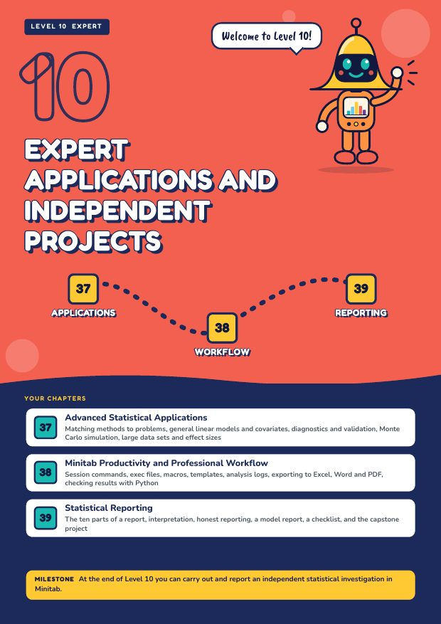
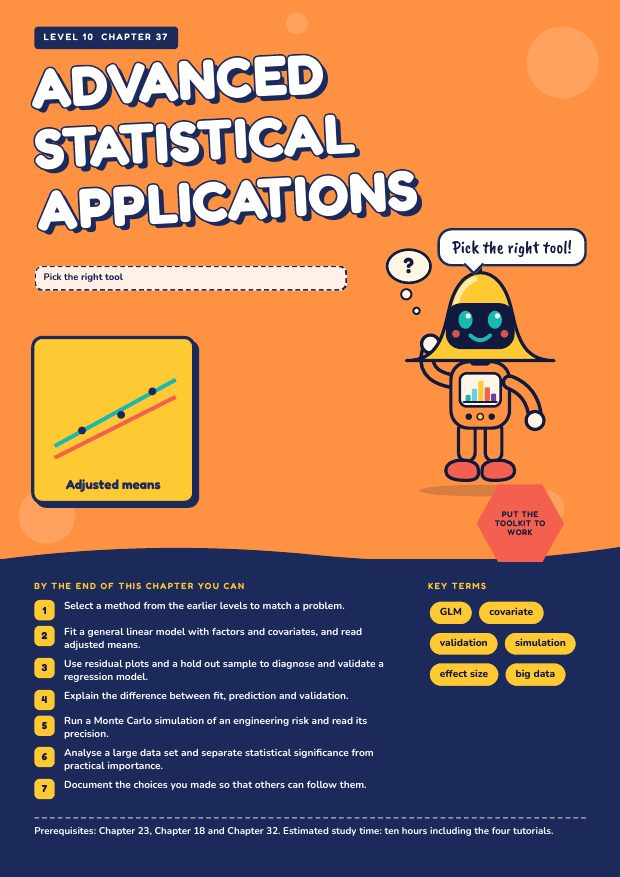
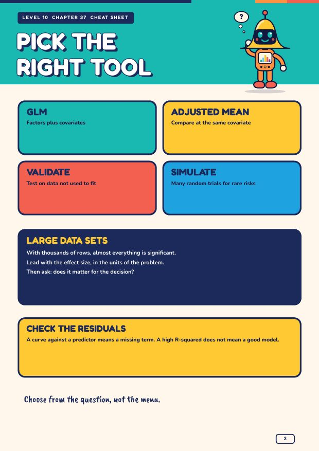

<table>
  <tr><td colspan="2"><a href="../README.md#-the-ten-levels">← Back to the levels index</a></td></tr>
  <tr><th colspan="2"><h3>🏆 Level 10: Expert Applications and Independent Projects</h3></th></tr>
  <tr><td colspan="2" align="center">
Combine everything into professional workflows, reports and independent projects.
</td></tr>
  <tr>
    <th rowspan="3">At a glance <a href="../Minitab%20Lessons/Minitab%20Lesson%20-%20Level%2010.pdf">→ Open the PDF</a></th>
    <td><code>🏆 Expert</code> <code>⏱️ 2 to 4 weeks</code> <code>📄 45 pages</code></td>
  </tr>
  <tr><td><code>📚 3 chapters (numbered 37 to 39)</code> <code>🗃️ 4 simulated datasets</code></td></tr>
  <tr><td><code>🧠 WHAT</code> <code>🎯 WHY</code> <code>🛠️ HOW</code> <code>✍️ Exercises and answer key</code> <code>📖 Glossary</code></td></tr>
  <tr>
    <td colspan="2" align="center">
      

Level opener

      

Chapter opener

      

Cheat sheet page

      
    </td>
  </tr>
</table>

## 📚 Chapters

<table>
<tr><th align="center">No.</th><th align="left">Chapter</th></tr>
<tr><td align="center"><b>37</b></td><td>Advanced Statistical Applications</td></tr>
<tr><td align="center"><b>38</b></td><td>Minitab Productivity and Professional Workflow</td></tr>
<tr><td align="center"><b>39</b></td><td>Statistical Reporting</td></tr>
</table>

## 🗃️ Datasets

All datasets are **simulated** and live in [`../datasets/`](../datasets/).

<table>
<tr><th align="left">File</th><th align="left">What it holds</th></tr>
<tr><td><code>L10_CH01_DS01_Strength_Supplier_Thickness_60.csv</code></td><td>Strength Supplier Thickness 60</td></tr>
<tr><td><code>L10_CH01_DS02_Building_Energy_200.csv</code></td><td>Building Energy 200</td></tr>
<tr><td><code>L10_CH01_DS03_Call_Handling_5000.csv</code></td><td>Call Handling 5000</td></tr>
<tr><td><code>L10_CH02_DS01_Weekly_Line_Measurements_6x20.csv</code></td><td>Weekly Line Measurements 6x20</td></tr>
</table>

---

[← Level 9](level-09.md)
